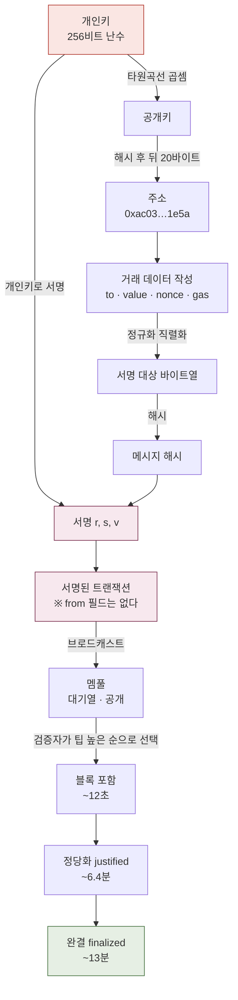
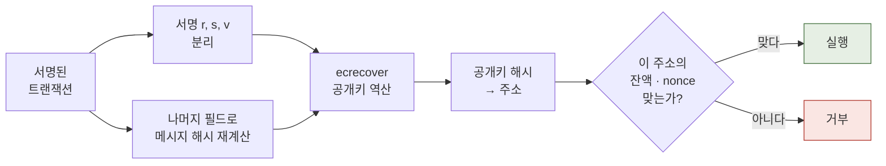

# 트랜잭션 동작 흐름도

서명된 거래 하나가 **만들어져서 되돌릴 수 없게 되기까지** 거치는 길.

---

## 1. 전체 흐름



---

## 2. 노드가 받은 트랜잭션을 검증하는 순서

받는 쪽에는 `from`이 없다. **서명에서 역산해 낸다.**



**이 구조가 막는 것** — 남의 주소를 `from`으로 적어 넣는 사칭. 적어 넣을 자리 자체가 없고, 서명에서 계산돼 나올 뿐이다.

---

## 3. 서명이 보호하는 범위

```
┌─────────────────────── 서명 대상 (payload) ───────────────────────┐
│  to        받는 주소                                               │
│  value     금액                                                    │
│  nonce     일련번호                                                │
│  gasLimit · maxFeePerGas · maxPriorityFeePerGas                   │
│  data      컨트랙트 입력                                            │
└────────────────────────────────────────────────────────────────────┘
          │
          │  이 안의 한 바이트라도 바뀌면 → 해시가 달라짐 → 서명 불일치
          ▼
      검증 실패
```

`Transaction.payload()`에 **넣은 필드만 보호된다.** 빠뜨린 필드는 중간에서 마음대로 바꿔도 서명이 통과한다.

> 실습 5에서 금액과 받는 주소를 각각 바꿔 보면 둘 다 즉시 검증에 실패한다.
> 둘 다 `payload()`에 들어 있기 때문이다.

---

## 4. 가스비가 갈라지는 지점

```
maxFeePerGas = 300 gwei  (내가 정한 상한)
├──────────────────────────────┬──────────┬────────────────┤
│ baseFee 190                  │ 팁 10    │ 미사용 100     │
│ 🔥 소각 — 아무도 못 가져감    │ 검증자   │ 안 냄          │
└──────────────────────────────┴──────────┴────────────────┘
         × 가스 사용량 21,000
         = 총 0.0042 ETH  (소각 0.00399 + 팁 0.00021)
```

- `baseFee`는 **내가 정하지 않는다.** 프로토콜이 블록마다 자동 산정한다.
- `maxFeePerGas < baseFee`이면 **블록에 들어가지 못한다.**
- 소각하는 이유는 ETH 가격이 아니라 **수수료 조작 방지**다. baseFee가 검증자 수입이면 블록을 일부러 채워 수수료를 올릴 유인이 생긴다.

---

## 5. nonce가 만드는 대기열

```
nonce   0       1       2         3        4
       [완료]  [완료]  [가스부족]  [대기]   [대기]
                        ↑ 막힘     └──── 실행 불가 ────┘
```

nonce는 **재사용 방지**와 **순서 보장**을 정수 하나로 동시에 해결한다.

- 2번이 묶여 있으면 3·4번은 가스를 아무리 높게 불러도 들어갈 수 없다.
- 푸는 법: **같은 nonce로 다시 서명해 덮어쓴다.** 가스를 올리면 "속도 올리기", `value=0`으로 자기 자신에게 보내면 "취소"다.

백엔드로 치면 **멱등키 + 시퀀스 번호**를 합친 것이다.

---

## 6. '확정'까지의 네 단계

| 시점 | 상태 | 되돌릴 수 있나 |
|---|---|---|
| 0초 | 서명·해시 생성 | 아직 아무 일도 안 일어남 |
| 즉시 | 멤풀 전파 | 언제든 교체·취소 가능 |
| ~12초 | 블록 포함 | **가능** — 재구성되면 빠질 수 있음 |
| ~6.4분 | 정당화 justified | 이론상 가능 |
| ~13분 | **완결 finalized** | 전체 지분 1/3을 소각해야 함 |

**트랜잭션 해시를 받은 것은 접수증이지 영수증이 아니다.** 거래소가 입금 반영에 시간을 두는 구간이 여기다.

---

## 참고

- [ethereum.org · 트랜잭션](https://ethereum.org/ko/developers/docs/transactions/)
- [ethereum.org · 가스](https://ethereum.org/ko/developers/docs/gas/)
- 실행: `bash run.sh SignatureMain`
